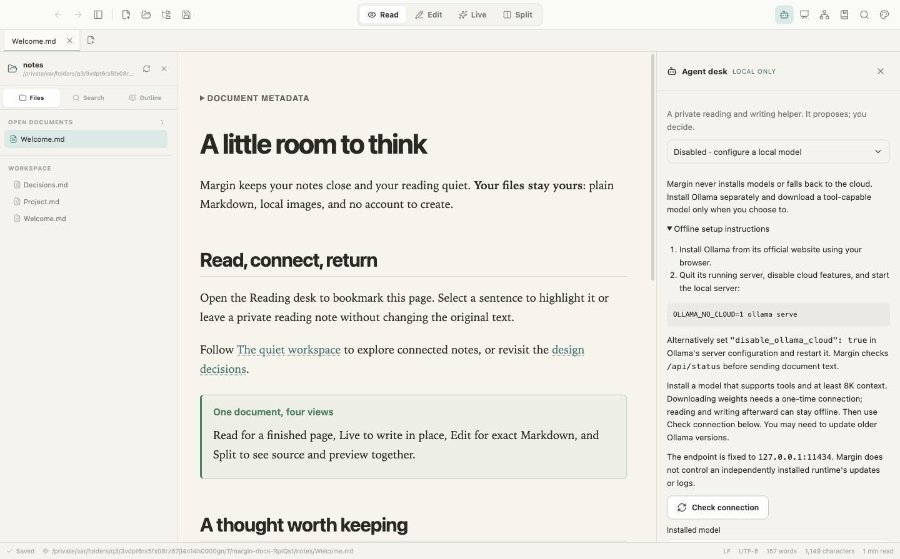
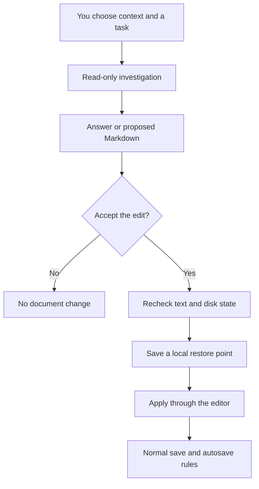

# Agent desk

[Documentation hub](README.md) · [User guide](USER_GUIDE.md) · [Architecture](ARCHITECTURE.md) · [Data and security](DATA_AND_SECURITY.md)

The optional Agent desk is a local reading and writing helper. It can explain, summarize, extract decisions/tasks/questions, draft Markdown, and propose clearer wording or note links. It starts disabled. Margin's ordinary reading, editing, and export features need no model or Ollama installation.



This is the actual desktop interface without inference. Real-model testing is deferred at the user's request to avoid RAM consumption; see the verification section below.

## Local setup

1. Install [Ollama](https://ollama.com/download) separately. The runtime and model weights are different installations. Margin does not install either or automatically download a missing model.
2. When you decide to use AI, select an already installed local model with tool calling and a reported context window of at least 8,192 tokens. Local inference consumes RAM and compute; simply building Margin does not load a model.
3. Disable Ollama cloud features and restart the actual server. With no server already running, a terminal launch can use:

```sh
OLLAMA_NO_CLOUD=1 ollama serve
```

For PowerShell:

```powershell
$env:OLLAMA_NO_CLOUD = "1"
ollama serve
```

Alternatively set `"disable_ollama_cloud": true` in Ollama's server configuration and restart it. An environment variable in one shell does not reconfigure an unrelated running desktop server. Follow the [official local-only instructions](https://docs.ollama.com/faq#how-do-i-disable-ollamas-cloud-features). Do not launch a second server over an occupied port.

4. Open the robot icon in Margin's toolbar. Choose **Check connection**, choose an installed model, then **Enable Agent desk**.

Margin uses only `127.0.0.1:11434`. Before sending document text it verifies `/api/status` reports `cloud.disabled: true`, checks installed-model metadata, rejects remote models, and checks tool/context capability through `/api/show`. Older runtimes without the status endpoint are refused rather than assumed offline. No cloud fallback, remote endpoint setting, account, or API key is provided.

Opening the disabled panel sends no Ollama requests. Checking/enabling reads metadata; generation starts only after **Start task**. The independently installed runtime still controls its updater, logs, OS permissions, and other clients. A localhost address alone does not prove that an arbitrary replacement backend is trustworthy.

## Choose permitted context

The default is your current document, or the passage selected when opening the desk. In Read mode select text and choose **Ask agent**. In Edit/Live/Split, use a source selection and **Use current selection**. **Use whole document instead** clears passage scope.

For precise in-place replacements, prefer selecting Markdown source. Rendered text can omit formatting; if a rendered selection cannot be matched exactly, the helper can answer about it but asks you to select source before replacing it.

**Attach notes…** selects additional files through a native file picker. Attachments are file snapshots; detach and reattach to refresh them. Removing one revokes it for later tasks. At most ten attachments, 1 MiB text each and 4 MiB aggregate text-memory units, are retained.

With an open workspace, **Allow search/read in “[folder]”** explicitly grants bounded access to that folder. This starts unchecked and resets when the workspace changes. Eligible unsaved open buffers overlay disk contents. Other folders and personal Reading desk annotations are not included.

Context is fixed at task start. Switching documents does not retarget a pending edit. Closing the panel cancels a running task and releases its session context, but does not shut down a separately running Ollama server. Focus Mode hides/unmounts the desk and therefore also cancels its running task.

## Tasks and results

| Task | Example | Result |
| --- | --- | --- |
| Ask | “Explain the reasoning in this passage.” | Answer with source references |
| Summarize | “Give me five important points.” | Cited summary |
| Extract decisions & tasks | “Find decisions, actions, and open questions.” | Structured Markdown; missing owners/dates should remain unknown |
| Revise passage | “Make this clearer without changing its meaning.” | Reviewable replacement of the fixed target |
| Draft Markdown | “Turn these notes into a project brief.” | One proposed new draft |
| Suggest note links | “Link useful terms to the attached notes.” | Proposed wiki-link edits |

Use **Start task**, or `Cmd/Ctrl+Enter` from the prompt field. Attach relevant notes or grant folder scope for useful cross-note links. The helper cannot discover unapproved folders merely because Margin opened them previously.

Each task starts fresh. There is no persistent conversation, background mission, multi-agent team, shell, browser, MCP execution, or autonomous notebook maintenance in Track A.

## Sources and activity

Answers can reference **C1**, **C2**, etc. Click a reference to expand its exact retrieved passage. Source cards identify the file/selection and line range where available. **Open source in editor** navigates to that document; a changed document produces a warning while the originally read passage remains visible.

Only actually retrieved citation IDs become clickable. Unknown or missing citations generate warnings. A valid citation proves a passage was supplied, not that every conclusion is correct. Check facts before relying on or accepting the result.

Long notes are read in bounded passages. The displayed source/character counts, cards, and warnings describe actual coverage; a partial search is not proof that something is absent from the entire notebook.

**Activity** shows observable tool operations and returned data, not private model reasoning. Search is literal and bounded. Generated answers cannot load images or activate arbitrary external links inside this panel; validated source navigation is the only enabled answer-link action.

## Review and control



Generation never changes a document. For a proposal, **Review Markdown diff** shows additions/removals, and **Full proposed Markdown** shows the complete replacement. Newly introduced unresolved/ambiguous wiki links are flagged.

- **Reject** discards the proposal without changing a buffer or source file.
- **Accept edit** rechecks the original text hash, target identity, and disk baseline. Newer edits/conflicts invalidate the proposal. A bounded restore point must be stored before applying through CodeMirror.
- **Normal autosave still applies after acceptance.** With autosave on, accepted text can save after its usual delay. Otherwise choose Save yourself.
- **Create draft** opens an unsaved tab, not a new file. Choose Save when you want a file.
- **Undo agent change** restores the pre-edit text only if the document still matches that change. It refuses to overwrite later human edits. Normal editor Undo is also available.
- **Stop task** aborts the current request and prevents late results from applying. It does not reverse an edit already accepted or stop a shared runtime.

One proposal targets one document or one draft. There is no multi-file transaction. Acceptance/rejection applies to the complete proposal; individual-hunk approval is not implemented. Use a separate draft for manual combinations if needed.

## Limits and storage

Inference requests use a short, one-minute model keep-alive. Ollama may retain weights briefly after a task, and other clients can affect its lifetime. Stop/closing the desk cancels Margin's work; it does not force-unload a shared model. No inference or model loading happens during a Margin build.

| Area | Ceiling |
| --- | --- |
| Concurrency/time/tools | One task; five minutes; twenty tool calls |
| Evidence | Ten note snapshots; up to 64,000 characters, further bounded by model context |
| A read | At most 120 lines and 12,000 characters |
| Editable target | At most 12,000 characters, smaller for limited model context |
| Proposed replacement/draft | 24,000 characters |
| Explicit attachments | Ten files; 1 MiB text/file; 4 MiB aggregate text-memory units |
| Folder | Existing workspace depth, symlink, file-count and snapshot limits |
| Restore points | Twenty rolling records / 50 MiB encoded restore data |

`agent-settings.json` in the app profile stores enabled/model selection. `agent-restore-points/` stores pre-edit text, target identity, time, and expected post-edit checksum. These restore files can contain private document text; they are local, not encrypted, and not permanent version history.

Conversations, evidence, and proposals otherwise remain session memory. Approved edits/drafts enter normal editor recovery. No permanent agent memory or vector database is added. Back up source files and the app profile separately; see [Data and security](DATA_AND_SECURITY.md).

## Troubleshooting

| Message/symptom | Next step |
| --- | --- |
| Ollama not running | Start the installed runtime in local-only mode when ready to use AI. Normal Margin use needs no server. |
| Cloud enabled | Reconfigure/restart the actual server; a variable in another shell is insufficient. |
| `/api/status` unavailable | Update Ollama; Margin will not guess whether it stays local. |
| Model missing/remote/unsupported | Select compatible installed local weights when you choose to install one; no automatic pull occurs. |
| Context/output limit | Select a smaller passage or narrow the task. Incomplete replacements are not applied. |
| Stale proposal | Generate a new proposal from current text. |
| Restore point cannot be stored | Free local space; applying fails safely. |
| Undo refused | Later edits exist. Preserve them and use editor Undo or a copy. |
| Wrong answer | Inspect its evidence, then revise or reject it. Accuracy is not guaranteed. |

## Verification status

The native Electron workflow has been exercised with a deterministic loopback Ollama-protocol fixture: disabled/default behavior, local-only checks, citations, review/reject/accept, restore/undo, stale text, cancellation, explicit folder access, and unsaved drafts. Library tests cover transport, boundaries, and proposal handling. This is UI/IPC/filesystem integration evidence, not real-model quality evidence.

**Real-model inference testing is deferred at the user's request to avoid RAM consumption. No model is downloaded or loaded by a build.** The build and protocol fixture do not require weights. See [Development](DEVELOPMENT.md) for maintainers' commands; live-model checks require separate approval.
