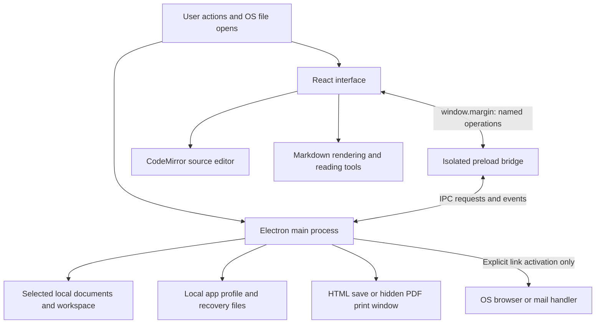
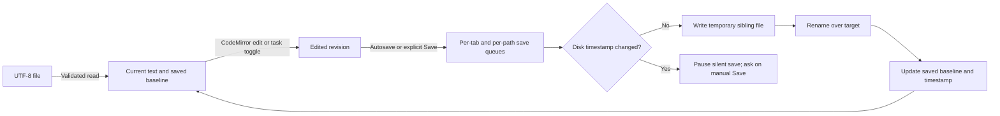
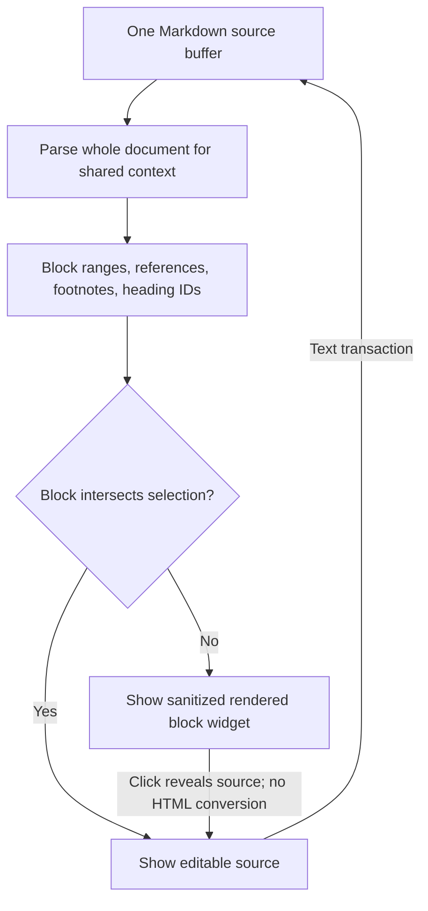
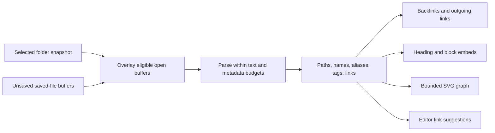

# How Margin works

[All documentation](README.md) · [Data and security](DATA_AND_SECURITY.md) · [Development](DEVELOPMENT.md)

Margin is an Electron application with a React renderer. Markdown files, not rendered HTML or an internal database, are the document source of truth. CodeMirror owns editable text in every editing mode. A bounded, rebuildable in-memory index adds linked-note features.

## 1. Process boundaries

The renderer has no Node.js integration and cannot import `fs` to browse the machine. Main-process operations validate requested paths and capabilities. A renderer request is not itself permission to read an arbitrary file.

| Layer | Responsibility | Main files |
| --- | --- | --- |
| Native host | Window lifecycle, menus, file dialogs, filesystem access, saves, recovery, assets, export, network gate | [main.cjs](../electron/main.cjs) |
| Bridge | Exposes only named operations and event subscriptions as `window.margin` | [preload.cjs](../electron/preload.cjs), [types.ts](../src/types.ts) |
| Workspace service | Portable path validation, safe traversal, discovery, literal search, bounded note snapshots | [workspace.cjs](../electron/workspace.cjs) |
| OS-open coordinator | Parses/queues startup, second-instance, and native open-file requests and tracks renderer delivery | [external-open.cjs](../electron/external-open.cjs) |
| App coordinator | Tabs, settings, saves, dialogs, navigation, recovery scheduling, workspace/index composition | [App.tsx](../src/App.tsx) |
| Editor | CodeMirror setup, selections, formatting hooks, image import/drop, table navigation | [EditorPane.tsx](../src/components/EditorPane.tsx) |
| Rendered page | Reader interactions, annotations, folds, search, scroll reporting | [MarkdownPreview.tsx](../src/components/MarkdownPreview.tsx) |
| Markdown engine | Parsing, sanitization, math, diagrams, local asset enhancement, export HTML | [markdown.ts](../src/lib/markdown.ts) |
| Connections | Note parsing/resolution, section extraction, bounded transclusion | [noteIndex.ts](../src/lib/noteIndex.ts), [noteRendering.ts](../src/lib/noteRendering.ts) |
| Reading metadata | Validation/persistence, quote anchors, annotation marks, heading folding | [readingState.ts](../src/lib/readingState.ts) |

Editor, Reading desk, graph, image viewer, and presentation code load on demand. Mermaid and export math-font CSS also use dynamic imports. They are bundled local assets, not network-loaded services.

## 2. Startup and native file opening

1. Main parses supported paths from OS/command-line requests and obtains the single-instance lock.
2. It creates the sandboxed window and registers main-process handlers. Production loads `dist/index.html`; development loads the exact configured loopback Vite URL.
3. Preload installs event listeners early, assigns a recovery epoch, and buffers external-open results until React subscribes.
4. React loads settings and reading metadata, restores the saved workspace, and asks main for a recovery session.
5. Once restoration is resolved, the renderer signals readiness for queued file deliveries and safe-close handling. External-open results carry delivery IDs and are acknowledged rather than assumed delivered.

This handshake avoids losing a Finder/Open With request while the renderer is still loading. Recovery generation numbers and per-renderer epochs prevent an older asynchronous snapshot from overwriting a newer one after a reload.

Settings and reading-library data live in renderer storage; workspace/recovery/remembered-path data lives in main-owned JSON files. See [the storage map](DATA_AND_SECURITY.md#storage-map).

## 3. Document state and save lifecycle

Each `DocumentTab` contains a stable tab ID; optional path; current and last-saved text; modification timestamp; LF/CRLF and BOM metadata; mode; save state; revision; selection; and reader/editor scroll positions. Its rendered DOM is not the persistent document model.

Important invariants:

- An edit during an in-flight save is not marked saved just because the earlier snapshot succeeded. The baseline advances to the text actually written; newer text remains edited.
- Per-path queues serialize writes. Save-target claims and the live open-path set prevent Save As from accidentally targeting a different open tab's file.
- Silent autosave never chooses overwrite in a conflict. Manual Save offers overwrite/recreate, save a copy, or cancel.
- File reads validate regular-file status, size, stable stat information before/after reading, and UTF-8 text. A changing read is retried within a bound, then reported.
- Text is normalized to LF in memory. Saving restores the detected LF/CRLF convention and UTF-8 BOM. This preserves editing syntax, not arbitrary byte-for-byte mixed-newline formatting or non-UTF-8 encodings.
- Atomic replacement reduces partial-write exposure but is not a version-history service, a multi-file transaction, or an unconditional power-loss guarantee.

Open files are checked for external changes on focus and on a six-second interval. Clean buffers can reload; changed local buffers become conflicts. There is no merge algorithm or permanent filesystem-watching daemon.

## 4. Source, Live, and Split share one editor model

Read mode renders Markdown. Edit and Split use CodeMirror source text; Split adds a rendered preview and proportional scroll coordination. Live adds CodeMirror replacement widgets for inactive Markdown blocks.

[livePreview.ts](../src/lib/livePreview.ts) maintains source ranges in a CodeMirror state field and maps them through transactions. The shared parse context matters: rendering each paragraph as an unrelated Markdown document would break reference links, footnotes, and duplicate heading IDs.

Clicking a widget sets an approximate source selection and returns control to CodeMirror. `Cmd/Ctrl+click` follows its links. Widgets are views, never a rich-text document to serialize back to Markdown. Search exposes source so matches stay editable. Selection changes and undo use the standard editor state/history.

Above 300,000 characters, live replacements are disabled. Source editing remains available. Typewriter scrolling and sentence/paragraph dimming are separate editor extensions. Table navigation is a Markdown-aware key binding, not an embedded spreadsheet.

## 5. Markdown rendering pipeline

1. Separate YAML-style front matter from the body while retaining source-line offsets.
2. Parse with `markdown-it` and local plugins: headings/anchors, wiki links, callouts, footnotes, definitions, marks/sub/sup, tasks, and KaTeX.
3. Emit and sanitize HTML with DOMPurify. Source-line metadata connects rendered task checkboxes to source edits; heading IDs connect outline navigation and folds.
4. Resolve note embeds against the current in-memory index. Preserve the embedded note's origin for links/assets, and namespace embedded IDs.
5. Resolve permitted local images through main-process asset reads and replace their sources with data URLs.
6. Lazily render Mermaid in strict mode, sanitize its SVG, and install it only if that render is still current. Theme-aware cached SVG avoids repeating identical work within bounds.
7. Add surface-specific behavior: code-copy controls, reader annotation marks, collapsed sections, and search highlights. Noninteractive export/presentation surfaces do not acquire the same editing behavior.

Async enhancement checks whether its surface is still current before applying results. A slow render for a previous document should not overwrite the next page. Mermaid rendering is queued because its renderer uses shared configuration. Parsing/highlighting/math still have computation cost; offline does not mean unbounded documents render for free.

Markdown HTML is untrusted content. It cannot introduce an arbitrary script, preload API, remote image, or unrestricted file request. Sanitization and session request filtering are separate protections; neither is replaced by the other.

## 6. Workspace discovery and connected notes

The folder tree loads a directory when expanded. Quick Open discovers supported files separately. Folder search reads bounded files and overlays eligible unsaved open buffers; it does not build a persistent full-text search database.

Connected-note snapshots read at most 2,000 files with per-file/aggregate limits. React overlays open buffers, prioritizes active/open documents under its memory limit, and parses metadata through `buildNoteIndex`. Unchanged notes reuse parsed objects. The index includes paths, titles, aliases, tags, and outgoing links; backlinks are derived by resolving other notes' links.

Resolution order is deliberate: an exact source-relative path first; a workspace-root path for wiki links; finally a unique short name or alias for pathless wiki links. Names are normalized for matching, but exact path matches are preferred. Standard Markdown links remain source-relative and do not acquire global alias fallback. Root escapes and unresolved/ambiguous targets are not silently redirected.

Inline/fenced code does not create connections. Front matter supports a small list syntax for aliases/tags, not arbitrary YAML evaluation. The note title uses the first heading when available, otherwise the filename stem.

### Transclusion and graph bounds

`enhanceNotes` expands whole-note, heading, or block embeds, tracks ancestors to stop cycles, and shares count/source/HTML budgets across a rendered surface. Section extraction preserves references/footnotes from the full owning note. The live-widget cache is bounded, and destroyed widgets release their counted allocations.

The graph is native SVG with a bounded static layout, computed when inputs/filtering change. It is not a continuous physics simulation. It shows up to 250 matching notes, deduplicates undirected edges for display, and inspects up to 200 outgoing links per indexed note for graph construction. The connection index can contain more links than the visible graph. Pan/zoom change the view transform, not note content.

Refresh is explicit or triggered when returning to the app after a throttle interval. There is no promise of instantaneous discovery of every external folder change.

## 7. Reading metadata is an overlay

A `ReadingRecord` is keyed by canonical saved path, or temporarily by `draft:<tab-id>`. It contains bookmark status, scroll offset/progress, collapsed heading IDs, annotations, and update time.

Annotations store a quote, prefix, suffix, offset, note, color, ID, and creation time. Capture uses DOM range endpoints against a normalized text-node map, including paragraph boundaries. Matching tries the unchanged offset/context and then searches for the quoted passage with context. Applying highlights wraps text segments without flattening inline markup; overlapping highlights are handled segment by segment.

Scroll reporting updates a synchronous ref immediately; UI updates are throttled. This prevents an immediate tab close from losing the last position before React renders. Reading-library persistence is debounced, flushed on unload, and explicitly checked during normal window close. If protected metadata cannot be saved, the close is canceled with a warning.

Highlighting and annotation do not generate document-source changes. A rendered task checkbox does. This distinction is visible in the save indicator and essential when changing reader interactions.

## 8. Export reuses rendering, not the current DOM

`createExportHtml` starts from the active buffer, runs sanitized rendering, expands bounded embeds, resolves assets, and embeds styles/math fonts. It disables task editing and converts resolvable wiki links to relative file links. Reader UI, annotation overlays, and folding controls are not the export source.

HTML export writes that standalone document through a user-chosen save dialog. PDF export creates a temporary local HTML document, grants only its hidden print window permission to load that exact file, waits for fonts, prints locally, writes the PDF, then destroys the window and removes the temporary directory in `finally`.

The exported Content Security Policy denies scripts and background resource loading. Body text relies on installed font fallbacks; math fonts are embedded. Linked notes are not automatically exported as a complete site.

## 9. Optional Agent desk

The lazy-loaded [AgentDesk](../src/components/AgentDesk.tsx) calls named preload operations implemented by [agent-host.cjs](../electron/agent-host.cjs). The host grants immutable target/attachment/folder snapshots, owns cancellation, and prepares restore points only after explicit acceptance. [agent.cjs](../electron/agent.cjs) implements the bounded read/search/proposal loop and fixed loopback Ollama transport, without SDK/framework dependencies, direct model filesystem access, shell execution, or a web tool.

The renderer's network policy is unchanged. Agent HTTP uses a separate allowlist: status/tags/show/chat at `127.0.0.1:11434`, no redirects/proxies/pull operations. Cloud-disabled status and installed local model capability are checked before document text is sent. Proposed edits are staged data; accepted changes recheck source identity/revisions and disk baseline, create a bounded restore point, then enter CodeMirror as ordinary undoable text transactions. No model is bundled or loaded during app startup/build. Read the [Agent desk guide](AGENT_DESK.md) for the full lifecycle and deferred real-model testing status.

## 10. Extension rules

For future changes, preserve the existing boundaries:

- Add file operations as validated main-process capabilities, not raw path access in React.
- Keep Markdown as the editing model; add editor transactions rather than serializing arbitrary rendered HTML.
- Keep index/graph/embed work bounded and cancellable; document new limits and truncation messages.
- Treat recovery, reading metadata, and source-file saves as different lifecycles.
- Add tests at the pure-library boundary and a native smoke step when browser/Electron behavior matters.
- Keep dependencies and assets bundled; introducing a network service changes the product's offline contract.

[Development workflow](DEVELOPMENT.md) · [Security model and backup guide](DATA_AND_SECURITY.md)
