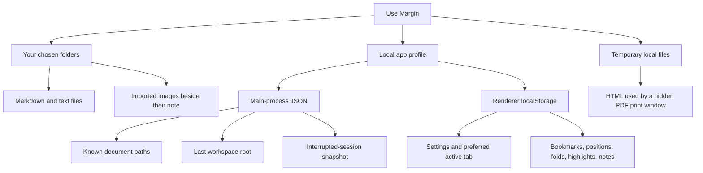

# Data, backups, limits, and security

[All documentation](README.md) · [User guide](USER_GUIDE.md) · [Architecture](ARCHITECTURE.md)

There are two separate things to preserve: your files and your Margin profile. Saving a Markdown file does not embed your personal reading notes into it. Exporting a PDF does not back up your notebook.

## Storage map

| Data | Location/identifier | Lifecycle |
| --- | --- | --- |
| Document source | The file path you opened/saved | Changed only by document-edit/save actions |
| Imported images | `assets/` beside the saved document | Copied with unique names; removing a Markdown link does not delete its image file |
| Last workspace | `workspace-state.json` in the app profile | Remembers one folder root; closing the workspace clears this saved root |
| Remembered file paths | `known-documents.json` in the app profile | Up to 2,000 previously registered paths, used to authorize bookmark reopening |
| Recovery snapshot | `recovery-session.json` in the app profile | Bounded drafts/tab state for interrupted exits; cleared on successful normal window close |
| Preserved invalid recovery | `recovery-session.json.invalid-<timestamp>` | A damaged/unsupported snapshot is renamed for preservation when possible |
| Settings | `localStorage["margin:settings"]` | Theme, typography, editor options, autosave, sidebar preference |
| Preferred active tab | `localStorage["margin:active-tab"]` | Useful when restoring a recovery session; not a permanent tab history |
| Reading library | `localStorage["margin:reading-library:v1"]` | Bookmarks, annotations, position/progress, collapsed headings |
| OS recent documents | Operating-system facility | Separate from Margin's remembered-path JSON; clearing the native recent list does not erase reading metadata |
| Note/search indexes, graph, visit history | In memory | Rebuilt or discarded; not a permanent database |
| PDF render input | OS temporary directory, `margin-export-*` | Removed after the PDF attempt; a forced termination can leave temporary files |

`localStorage` is persisted by Electron/Chromium inside the profile; there is not a user-editable `reading-library.json` sidecar beside each note. Avoid editing Chromium storage database files by hand.

### Where is the profile?

Main uses Electron's `app.getPath('userData')`. For a normal packaged Margin build, typical default locations are:

| Platform | Typical profile directory |
| --- | --- |
| macOS | `~/Library/Application Support/Margin/` |
| Windows | `%APPDATA%\Margin\` |
| Linux | `$XDG_CONFIG_HOME/Margin/`, normally `~/.config/Margin/` |

The application name, build environment, and an explicit launch-profile override can change this. A source run can use `margin-markdown` instead of `Margin`. Development's HTTP origin and production's file origin also have separate renderer storage; sharing a profile directory does not guarantee shared localStorage. Verify the directory in use before backing up or troubleshooting it.

The automated desktop test and screenshot tool create and assert their own temporary profile paths. They do not use your normal reading library.

## Reading records and retention

Saved-file records use the canonical absolute path as their key. Draft records use `draft:<tab-id>`. A record stores the name/path, bookmark flag, scroll offset, progress ratio, collapsed heading IDs, annotations, and an update time.

Each annotation stores the quote, nearby prefix/suffix, a text offset, a note, color, ID, and timestamp. Quotes and notes can contain sensitive document content, even if the Markdown file itself is stored somewhere else.

- Save As copies the current record to the new saved path; saving a draft migrates its draft record.
- Moving/renaming a file outside Margin does not automatically re-key its annotations or bookmarks. Moving a notebook to another machine can change absolute paths even when the relative folder layout stays the same.
- Bookmarks and annotated records have retention priority. Old unmarked reading positions are expendable, so position-only records can be pruned under count/size/quota pressure.
- The serializer keeps at most 1,000 unmarked positions in addition to protected records, subject to the overall 2,000-record/size bounds. It does not silently remove protected annotations just to fit more positions.
- If protected metadata alone cannot fit, saving reports an error. Normal window close attempts a synchronous save and cancels closing if it fails. Free disk space or remove unneeded annotations/bookmarks before quitting.

Malformed/out-of-bounds stored reading data is validated on load; invalid records are ignored, and an unreadable/oversized library can load as empty. This validation is another reason to keep profile backups instead of depending on recovery as your only copy.

## Backup and restore

### Back up both halves

1. Save every draft you want to keep permanently. Resolve conflicts and wait for the saved indicator.
2. Quit Margin normally so pending profile changes have a chance to persist. Do not force quit to bypass a storage warning.
3. Back up your Markdown/text folders and their image `assets/` folders.
4. Back up the entire active app profile as a separate, private backup. Preserve its Chromium storage directories as well as the main-process JSON files.
5. Keep ordinary file/version backups too. An app-profile snapshot does not contain a complete permanent copy of every saved document.

### Restore cautiously

With Margin closed, preserve the current profile before restoring an earlier full copy. Reopen the app and check the workspace, a known bookmark, and an annotation. Restore the document files to the same paths when possible. There is no built-in profile merge, reading-library import/export, path-migration assistant, or cloud sync.

Keep development and packaged profiles separate unless deliberately testing a migration. Do not commit real profiles, recovery snapshots, or private notes to the Git repository. The included screenshots use public demonstration content and a throwaway profile.

### Troubleshooting a profile

If you need to test whether a profile is damaged, first back it up and test with a separate profile rather than deleting the original. A reset loses local settings and reading metadata; it does not delete Markdown files in your chosen folders. A different build/profile may simply have different origin storage, not corrupted data.

Do not delete a recovery snapshot until you have saved any recovered unsaved text elsewhere. Preserved `.invalid-*` files may be the only remaining copy of a damaged draft.

## Recovery is not version history

Recovery snapshots are normally scheduled about one second after tab-state changes. Saved, clean tabs can be reopened from disk, so their full text is not duplicated unnecessarily. Dirty tabs/drafts retain text and, when needed, a saved baseline. Restoring prioritizes unsaved work over clean tabs when memory bounds are reached.

If a dirty recovered file changed on disk while Margin was closed, the restored tab becomes a conflict; it is not silently written over the new disk version. If the original file is missing or cannot be opened, dirty text can return as a pathless recovered draft. Clean missing files can be skipped.

Normal close resolves save/discard decisions and clears the recovery snapshot. A deliberate discard is not an instruction to restore that discarded edit next launch. The app has no historical revision browser, merge tool, or guarantee of recovering keystrokes that never reached its debounce/persistence boundary.

## Resource limits

These are protective ceilings, not recommended working-set targets. MiB below means 1,048,576 bytes. JavaScript strings/JSON have separate character/code-unit limits where noted; non-ASCII text does not have a one-character/one-byte relationship.

| Area | Bound | Behavior at the boundary |
| --- | --- | --- |
| Open/save one document | 25 MiB of UTF-8 data | Reject oversized input/output with an error |
| Open tabs | 100 | Ask you to close tabs before opening more |
| Retained open document text | 200 MiB, including distinct saved baselines | Bound new opens/restoration |
| Recovery | 50 MiB retained text; 64 MiB encoded JSON file | Report inability to write/read safely rather than pretending it saved |
| Image asset | 20 MiB | Skip/reject oversized or unsupported images |
| Directory listing | 2,000 entries per directory | Mark truncated results |
| Workspace discovery | 50,000 entries, depth 64, up to 10,000 supported documents | Mark discovery/Quick Open results as limited |
| Folder query | 256 characters | Bound request complexity |
| Folder search data | 5 MiB/file; 512 MiB scanned total | Skip oversized files/report limited results |
| Folder search output | 200 matches total; 20/file; bounded excerpts | Return limited results, not every match |
| Unsaved search overlays | Up to 100 buffers / 50 MiB | Excluded unsaved paths are not silently substituted with stale disk contents |
| Connected-note disk snapshot | 2,000 files; 1 MiB/file; 16 MiB total source | Report skipped/limited notes |
| Connected-note renderer text | 8,388,608 UTF-16 code units total; open buffers participate; oversized individual buffers excluded | Prioritize eligible active/open notes, then other snapshot notes |
| Connection metadata | 400 outgoing links, 200 tags, 20 aliases per note; 40,000 links across the index | Mark limited connection results |
| Live block replacement | 300,000 document characters | Keep source editing instead of live rendering |
| Embeds | At most 2 expansion levels, 100,000 source characters/section, 32 expansions, 500,000 source characters/surface | Leave deep, cyclic, or oversized transclusions as links |
| Embed HTML/cache | 4,194,304 generated HTML characters per surface; bounded live render cache | Stop expansion/evict cache entries |
| Graph | 250 matching notes; at most 200 outgoing links/note inspected for display edges | Show a bounded subset; filters can narrow it |
| Per-document annotations | 200; quote up to 10,000 characters; note up to 20,000 | Refuse more/longer annotations |
| Reading library | 2,000 records; 4,194,304 serialized JSON characters | Prune expendable positions first; report protected-data storage failures |

Workspace traversal ignores `.git`, `.hg`, `.svn`, and `node_modules`. Symbolic links/junctions inside a workspace are not followed. This is a deliberate capability boundary; a symlinked note may be available through a separate explicit file-open workflow, but is not part of workspace traversal.

## What offline means

The packaged app has no accounts, analytics, telemetry, AI service, hosted sync, remote font loading, or background HTTP feature. Local rendering/indexing happens on your device. A main-process session request filter rejects web requests and direct file loads outside the packaged assets.

There are narrow exceptions, not a general network permission:

- `data:`, `blob:`, and `about:` resources support local generated content.
- Each hidden PDF window can load its one registered temporary HTML file. This exception is removed afterward.
- Development allows HTTP/WebSocket requests only to the configured `127.0.0.1:5173` Vite server, plus development tooling. This is not a packaged-app dependency.
- Explicitly activating an HTTP/HTTPS/mail link hands it to the OS browser/mail handler. That external application can use the network under its own settings. Opening a link is different from background fetching by Margin.

Dependencies/Electron downloads during installation, developer tools, Git/GitHub, Docker image pulls, and CI are development activities, not evidence that an installed app needs an online session. There is no automatic update workflow implemented here.

Spellcheck uses macOS's native service only. Windows/Linux spellcheck remains disabled rather than downloading dictionaries behind the offline contract.

## Filesystem and rendering security

### Capability model

- A user file-open/save dialog or a validated native-open request registers a document path with main.
- A selected workspace authorizes bounded operations inside its canonical root. Requests use validated relative paths; traversal, invalid path forms, and symlink escapes are rejected.
- Reopening a saved bookmark requires a registered or locally remembered path; arbitrary renderer-provided filenames do not become unrestricted reads.
- Without a workspace, document links are constrained to the source document's directory and descendants.
- Assets are stricter: relative images must resolve inside the owning document's directory, even when the notebook workspace has a broader root. Absolute, remote, and parent-escaping images are blocked. An embedded note uses its own asset directory.
- New missing-note creation and image filenames use exclusive creation, avoiding overwrite of an existing file. Image import writes beside a saved, still-open, nonconflicted document.

### Untrusted Markdown

The renderer uses context isolation, sandboxing, no Node integration, a narrow bridge, and restrictive content policies. Markdown HTML is sanitized. Mermaid runs in strict mode and its SVG is sanitized separately. Remote/unsafe resource loading is blocked even when Markdown contains a URL.

The export policy allows embedded data images/fonts and local inline styles, not active scripts. Task interactions and app controls are not exported as executable functionality. Explicit links can still point outside the notebook, so review where a link goes before choosing it.

### Boundaries and non-goals

Offline and local-first do not mean encrypted. Markdown files, image assets, annotation text, paths, and recovery data are not encrypted by Margin. They inherit OS account permissions and any disk/backup encryption you use. Atomic saves use restrictive defaults for new files but do not replace OS access control or backups.

This model limits ordinary untrusted-content/file-path exposure; it is not a guarantee against malware already running as your user, a compromised Electron runtime/dependency, or a hostile local account with access to your profile. No camera/microphone/location workflow is needed; permission requests are denied. There is no plugin execution model or permission manager to enable one.

[User troubleshooting](USER_GUIDE.md#10-when-something-looks-wrong) · [Implementation boundaries](ARCHITECTURE.md)
