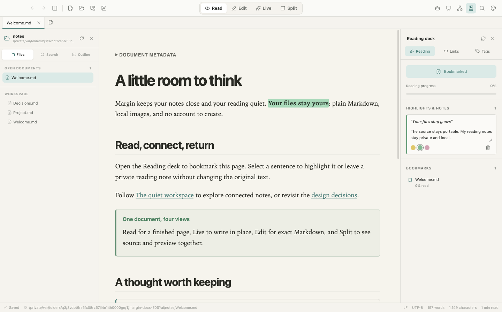

# Margin documentation

Margin is a local-first Markdown reader and editor. Your documents are ordinary files; the app adds a reading surface, a source-preserving live editor, and a bounded folder index for connected notes.

The toolbar changes views, the left sidebar navigates files, and the right Reading desk keeps personal reading notes separate from the document.

## Choose a guide

| I want to… | Start here |
| --- | --- |
| Run the app, read, edit, annotate, and export | [User guide](USER_GUIDE.md) |
| Set up the optional local reading/writing helper | [Agent desk](AGENT_DESK.md) |
| Understand how the pieces work together | [Architecture](ARCHITECTURE.md) |
| Find my data, back it up, or understand file/network access | [Data and security](DATA_AND_SECURITY.md) |
| Build, test, package, or extend the app | [Development](DEVELOPMENT.md) |
| Check benchmark coverage and deliberate exclusions | [Feature coverage](FEATURES.md) |
| Try the features with a small connected notebook | Open this documentation's [examples](examples/Welcome.md) folder in Margin |

## The short version

1. Open a file for standalone reading, or open a folder for connected notes.
2. Use **Read**, **Live**, **Edit**, or **Split**. All editing modes share the same Markdown source.
3. Save Markdown normally. Use the Reading desk for bookmarks, highlights, and annotations that should not change that source.
4. Export HTML/PDF when you need a rendered copy. Back up the original files and the app profile when you need to preserve both documents and reading metadata.

The guides describe the implementation in this repository, not every feature of Typora, iA Writer, or Obsidian. Cloud sync, accounts, plugins, collaboration, and a database-backed knowledge system are intentionally outside this app's scope.

Screenshots use demonstration notes and an isolated app profile. They are real application captures, not interface mockups. See [visual assets and screenshot reproduction](assets/README.md).

[Repository quick start](../README.md)
