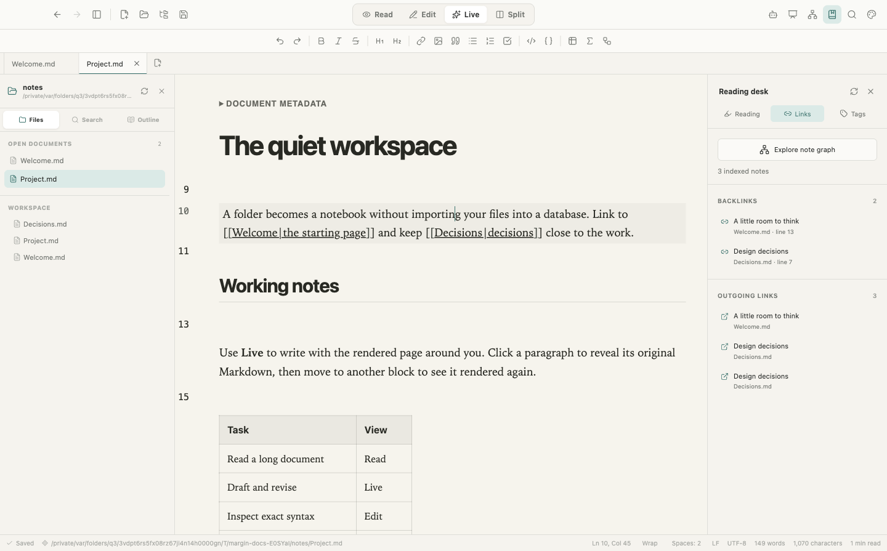
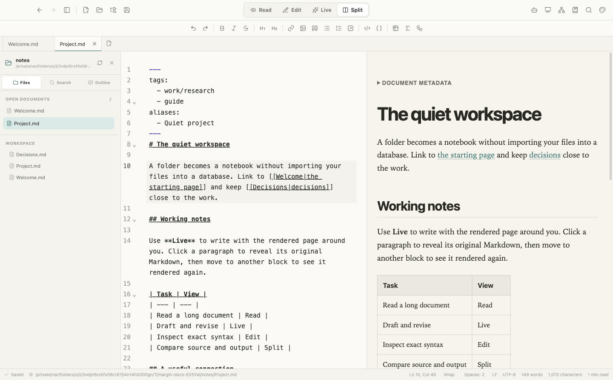
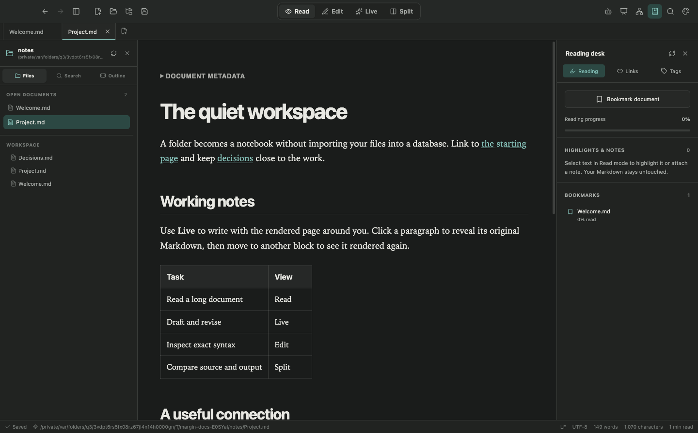
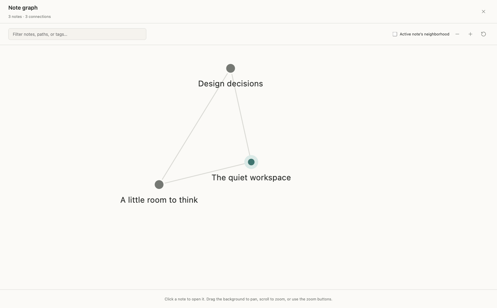
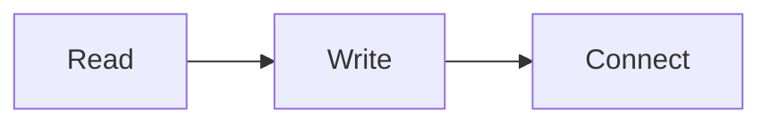

# User guide

[All documentation](README.md) · [Data and backups](DATA_AND_SECURITY.md) · [Developer setup](DEVELOPMENT.md)

This guide follows a complete workflow: open a notebook, read and annotate, edit, connect notes, and export. Throughout, **Cmd/Ctrl** means Command on macOS and Control on Windows/Linux.

Margin also has an optional, initially disabled [Agent desk](AGENT_DESK.md). It uses a separately installed local Ollama model to answer questions and propose reviewed edits. It is not required for the workflows below, and building the app never downloads or runs a model.

## 1. Start Margin

### Packaged app

Open the complete application supplied for your operating system. You do not need Node.js or npm to use it.

On this project's Apple Silicon Mac build, from the repository directory:

```sh
open release/mac-arm64/Margin.app
```

An Intel Mac build normally lives at `release/mac/Margin.app`. Keep the entire `.app` bundle: the executable inside `Contents/MacOS` is not a standalone program. Windows uses the configured NSIS installer; Linux packaging produces AppImage/DEB files. Build packages on the appropriate platform; see [Development](DEVELOPMENT.md#packaging-and-distribution).

### Run from source

With a supported Node.js version and dependencies installed:

```sh
npm ci
npm run dev
```

This opens the desktop app and a local development server. Stop development with `Ctrl+C` in the launching terminal. For a production-style run without the development server:

```sh
npm run build
npm start
```

Dependency installation and building can require network access. Reading and editing with the installed app do not.

## 2. Learn the window


From left to right:

- **Left sidebar:** Files, folder Search, and the current document's Outline. The Files view also lists open documents.
- **Center:** the active document. The top toolbar selects Read/Edit/Live/Split. Tabs below the toolbar switch documents.
- **Right Reading desk:** Reading, Links, and Tags. Open it with the book icon or `Cmd/Ctrl+Shift+L`.
- **Optional Agent desk:** the robot icon opens local-helper setup in the same right-hand area, replacing the Reading desk while open. It starts disabled; opening setup does not load a model. See the [Agent desk guide](AGENT_DESK.md) before configuring it.
- **Bottom status bar:** save status, path, cursor information in editing modes, word count, and estimated reading time. Editing modes also expose word-wrap and indentation controls.

Use `Cmd/Ctrl+Shift+P` for the command palette when you cannot find an action. Toolbar buttons have descriptive tooltips. `F8` hides surrounding chrome for Focus Mode; press it again to return. Focus Mode and sentence/paragraph writing focus are separate settings.

## 3. Open files or a notebook folder

**Open File** (`Cmd/Ctrl+O`) opens Markdown/text files without moving them. Supported extensions are `.md`, `.markdown`, `.mdown`, `.mkd`, and `.txt`. Documents must be valid UTF-8; UTF-16 and binary files are not supported. Existing LF/CRLF line-ending style and a UTF-8 BOM are retained when saving.

**Open Folder** enables a workspace. Margin remembers its root, loads directory entries on demand, and builds bounded file/search/connection indexes. This does not import files into a permanent database. There is one active workspace; changing it does not require closing independently opened document tabs.

Try this repository's `docs/examples` folder. Open `Welcome.md`, follow its links, and look at the Reading desk and graph. Copy that folder elsewhere first if you want to preserve the examples unchanged.

Navigation tools:

| Need | Action |
| --- | --- |
| Find a file by name/path | Quick Open, `Cmd/Ctrl+P` |
| Find text across the folder | Find in Folder, `Cmd/Ctrl+Shift+F` |
| Find within the active document | `Cmd/Ctrl+F` |
| Replace source text | `Cmd+Option+F` on macOS; `Ctrl+H` elsewhere |
| Jump to a heading | Outline in the left sidebar |
| Revisit open documents | Back/Forward in the toolbar |
| Reopen a recently closed tab | `Cmd/Ctrl+Shift+T`; recent-tab history is session-only |
| Refresh files and connections | Refresh in the sidebar or Reading desk |

Folder search is literal, with match-case and whole-word options; it is not a regular-expression engine. Unsaved contents of saved, open files inside the workspace replace their disk versions in results. Pathless drafts are not folder files. Search and indexing report when their limits omit results; see [the limits reference](DATA_AND_SECURITY.md#resource-limits).

Margin also accepts OS Open With/file-association requests and file drops. To make it the default on macOS, use Finder → Get Info → Open with → Margin → Change All. Removing a file from the sidebar or closing a folder does not delete the file.

## 4. Choose a reading/editing mode

| Mode | What it does | Best for |
| --- | --- | --- |
| Read | A rendered page with reading tools | Long documents, annotation, presentations |
| Live | Renders inactive blocks; reveals source around the selection | Writing with immediate visual feedback |
| Edit | Full Markdown source in CodeMirror | Precise syntax and large documents |
| Split | Source beside a synchronized rendered preview | Checking source against output |

Existing files open in Read mode; newly created drafts start in Live. A mode change does not convert or rewrite the document.



In Live mode, click a rendered block to edit its source. Move the cursor away to render it again. Use `Cmd/Ctrl+click` to follow a link without entering that block. Undo/redo works on Markdown edits. While the editor's search panel is open, Live exposes source to make matches editable. Documents above 300,000 characters use source rather than live block replacements.



**Word wrap is on by default.** Toggle it in Settings, the status bar, or with `Alt/Option+Z`. Soft wrapping does not insert newline characters into the file. Source code blocks and wide tables may still scroll horizontally in the reader.

## 5. Read, bookmark, and annotate

### Reading appearance

Settings separates the interface theme from the reading surface. Choose System/Light/Dark for the interface and Paper/Snow/Sepia/Midnight/Custom for the page. Reader font family, size, line height, and page width are independent of editor typography.



The default reader uses serif text at 18 px, line height 1.72, and a 760 px maximum content width. System font fallbacks can look different across platforms; the app does not download fonts.

### Bookmarks and reading position

Open the Reading desk's Reading tab and choose **Bookmark document**, or use `Cmd/Ctrl+Shift+D`. Click a bookmark to reopen it at its saved position. Scroll position and percentage are recorded locally. The percentage describes the page's scroll position, not which words you have actually read; typography changes can shift the exact restored location.

Save drafts before relying on a file bookmark. Bookmarks are path-based: moving a file in Finder/Explorer does not automatically migrate its reading metadata. Save As within Margin copies the current reading record to the new path.

### Highlights and notes

1. Switch to **Read**.
2. Select text, including text spanning more than one paragraph if needed.
3. Choose **Highlight** or **Add note** in the selection toolbar.
4. In the Reading desk, edit the note or choose yellow, green, or pink.
5. Click the quoted text to jump back; use its trash button to delete the annotation.

These annotations do not change the Markdown and are not included in HTML/PDF exports. They belong to the local app profile. The app stores the selected quote and surrounding context so it can relocate a highlight after some text edits. If the passage has been removed or changed too much, the note remains available but jumping to it reports that the text changed.

The Markdown syntax `==marked text==` is different: it is part of the document and renders in other compatible tools and exports.

### Folding, images, and slides

- Click a heading's chevron to hide its section until the next heading of equal or higher level. The command palette also has expand/collapse-all actions. Collapsed heading IDs are saved with reading metadata.
- Click a rendered local image to open the image viewer. `+`/`-` zoom, `0` fits, arrow keys change images, and `Esc` closes. Scroll the enlarged image to pan.
- Press `F5` or choose Present Document. Level 1/2 headings and horizontal rules split slides, except inside code blocks. Right/Down/PageDown/Space advances; Left/Up/PageUp goes back; Home/End jumps to the first/last slide; `Esc` exits. This is a local presentation view, not a slide-file exporter.
- Task checkboxes in the normal rendered document are editable: toggling one changes the Markdown and participates in saving. Presentation/export checkboxes are read-only.

## 6. Write and save safely

Use formatting actions for headings, bold/italic, links, code, lists, quotes, and tables. Standard copy/paste and undo/redo work in the source-based editing modes. A URL pasted over selected text becomes a Markdown link.

For tables, use **Insert or format table**, then `Tab`/`Shift+Tab` between cells. `Tab` in the final cell adds a row. Outside a recognized table, normal indentation applies.

Writing Settings include line numbers, code folding, visible whitespace, font/size/line height/width, 2–8-column tab width, and tab-versus-space indentation. Typewriter mode keeps the active line near the middle. Sentence/Paragraph focus dims surrounding text; Off restores normal contrast. Spelling uses the on-device macOS service only; it is disabled on Windows/Linux because no offline dictionary is bundled.

### Autosave versus Save

Autosave is on by default, with a 1.2-second delay after editing stops. It applies only to files that already have a saved path. **Save** (`Cmd/Ctrl+S`) chooses a path for a draft; **Save As** chooses a different target. Existing files are replaced with a same-directory temporary-file-and-rename operation, not edited in place a fragment at a time.

Read the save indicator. Edited/saving/conflict/error are not equivalent to saved. If a file changes externally while you have edits, autosave pauses and the next manual Save asks whether to overwrite, save a copy, or cancel. Prefer **Save a Copy** when you need to keep both versions. If an unchanged open file is edited by another app, Margin checks on focus and periodically and can reload it automatically. This is conflict detection, not a merge editor or version history.

Closing an edited tab/window asks you to save, discard, or cancel. A normal quit clears crash-recovery tabs after resolving changes; it does **not** promise to reopen every tab next launch. The selected folder, settings, and durable reading metadata remain. Interrupted exits can restore bounded drafts/tabs from the local recovery snapshot. Recovery is not a backup system; see [Data and security](DATA_AND_SECURITY.md#recovery-is-not-version-history).

## 7. Connect notes

Open the containing folder for the most complete connection view. The Reading desk's **Links** tab shows backlinks and outgoing links; **Tags** groups indexed notes. Unsaved open buffers participate after a short update delay.

### Link syntax

```markdown
[[Project]]
[[Project|A friendlier label]]
[[Project#Working notes]]
[[Decisions#^next-action]]
![[Decisions#A guiding principle]]
[Project](Project.md#working-notes)
```

`[[…]]` follows a note; `![[…]]` embeds its rendered content. A heading embed includes that heading's section. Put `^next-action` at the end of a paragraph to create a block reference. A block embed can use `![[Decisions#^next-action]]`.

Start typing `[[` in the editor for note suggestions. Use an explicit folder path such as `[[research/Project]]` when names repeat. Resolution prefers paths relative to the source note, then workspace-root paths for wiki links, then a unique short name/alias. Ambiguous names are not arbitrarily redirected. A missing/unresolved note can offer creation: choose a `.md` path inside the selected folder. The parent folder must already exist, and an existing file is never overwritten by this action.

For a standalone file, relative document links are restricted to its directory and descendants. For cross-folder notebooks, open a common workspace root that contains all linked notes. Images have the stricter per-document-directory rule even in a workspace.

### Aliases and tags

Margin reads simple front-matter lists, not a complete YAML configuration language:

```markdown
---
aliases: [Quiet project, Research plan]
tags:
  - reading
  - work/research
---
# Project

An inline #reading tag works too.
```

Tag filters include nested descendants: selecting `work` includes `work/research`. Link/tag-looking text inside inline or fenced code is not indexed. Front matter appears as metadata rather than ordinary body prose.

### Graph and embeds



Open Note Graph with `Cmd/Ctrl+Shift+G`. Filter by title/path/tag or choose the active note's neighborhood. Drag the background to pan, use the wheel/buttons to zoom, and click a node to open it. The graph is a bounded navigation map, not a canvas editor or an exhaustive knowledge model.

Embeds keep asset paths relative to the embedded note. Section embeds preserve that note's reference-link and footnote definitions. Recursive/deep/large embeds remain links; they are deliberately bounded to avoid freezing a page. The graph can show at most 250 matching notes. A sparse graph can mean a limit or unresolved links, not that files have been deleted.

## 8. Rich Markdown and local images

Common examples:

````markdown
- [ ] A task
- [x] A finished task

Text with a footnote.[^detail]
[^detail]: A longer explanation.

> [!NOTE] A helpful aside
> This is a callout.

> [!TIP]- Collapsed until opened
> Use + instead of - to start expanded.

Inline math: $E = mc^2$.


````

Tables, definitions, strikethrough, subscript, superscript, syntax-highlighted fenced code, and sanitized raw HTML are supported too. Invalid math/diagrams can display an error; correct their source in Edit mode. Raw scripts, executable embeds, and arbitrary HTML styling are not supported.

For an image, save the document first, then use the Image button or paste/drop image files into the editor. Margin copies supported images into `assets/` beside the saved note and inserts a relative Markdown link. Name collisions use a suffix; existing assets are not overwritten.

```markdown

```

Remote images, absolute filesystem images, and `../` images escaping the note's directory are blocked. Keep each note's assets in its own directory or a descendant. Supported formats are PNG/JPEG/GIF/WebP/SVG/AVIF/BMP, up to 20 MiB each. Local SVG images are displayed as images, not treated as trusted app code.

## 9. Export and share

Use **File → Export as HTML** or **Export as PDF**. Exports use the current buffer, including edits not yet saved to the source file. They contain a freshly rendered document, not a screenshot of the window.

- HTML bundles styles, supported local images, math fonts, rendered diagrams, and expanded note content. Body fonts use system fallbacks; they are not downloaded or bundled as a custom font family.
- PDF is generated locally through Electron's print engine, using an A4 page and print styles. Foldable callouts expand for PDF output. It is not a print-dialog/settings UI.
- Wiki links become relative file links where resolution succeeds; linked notes are not all exported as separate pages. An HTML export is not a published website or a portable copy of the entire notebook.
- Personal highlights, annotations, bookmarks, and reading progress are excluded. Save/backup the original Markdown, images, and app profile separately if you need those.
- Explicit external links remain user-activated links. Exporting does not fetch remote resources.

## 10. When something looks wrong

| Symptom | What to check |
| --- | --- |
| Long lines do not wrap | Word Wrap in Settings/status bar; `Alt/Option+Z`. Wide rendered code/tables can still scroll. |
| Backlinks or tags are missing | Open the common folder, refresh connections, check ambiguous names and index-limit warnings. |
| A note embed stays a link | Missing/ambiguous target, recursion, section not found, depth/size limits, or indexing still loading. |
| An image is absent | Save the note, use a supported local format, keep the asset inside the note's directory, check the 20 MiB limit. |
| Highlight no longer jumps | Its original quote changed; the saved annotation remains in the Reading desk. |
| Autosave stopped | Conflict/error/read-only/moved file; use manual Save to inspect the conflict or Save As to preserve a copy. |
| App refuses to quit with a reading-storage warning | Free disk space or remove unneeded annotations/bookmarks; do not force quit if you need unsaved metadata. |
| Tabs did not reopen after a clean quit | Expected: full-tab restoration is crash recovery, not persistent normal-session history. |
| Same file has no bookmarks in a different build | Development and packaged apps can use different profiles; paths and profile origin matter. |
| Spelling unavailable on Windows/Linux | Expected offline limitation, not a missing account/download. |

For keyboard coverage see the [shortcut reference](../README.md#keyboard-shortcuts). For storage paths, recovery, backup, and all limits see [Data and security](DATA_AND_SECURITY.md).
