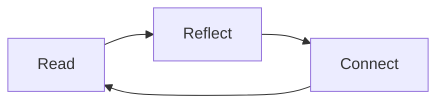

# A little room to think

Margin keeps your notes close and your reading quiet. **Your files stay yours**: plain Markdown, local images, and no account to create.

## Read, connect, return

Open the Reading desk to bookmark this page. Select a sentence to highlight it or leave a private reading note without changing the original text.

Follow [[Project|The quiet workspace]] to explore connected notes, or revisit the [[Decisions#Small by design|design decisions]].

> [!TIP] One document, four views
> Read for a finished page, Live to write in place, Edit for exact Markdown, and Split to see source and preview together.

## A thought worth keeping

![[Decisions#A guiding principle]]

## A small reading list

- [ ] Explore the linked project note.
- [ ] Try a highlight and an annotation.
- [ ] Export a copy as HTML or PDF.

## An offline workflow

For another view of this notebook, open the note graph. These sample files are safe to copy into a separate folder before experimenting. #guide
